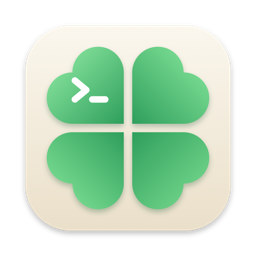
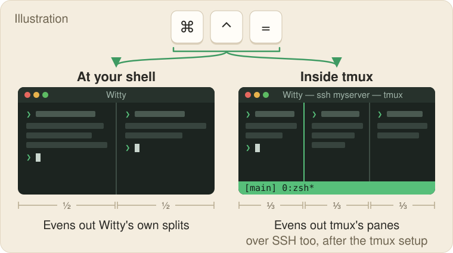

<p align="center">
  
</p>

<h1 align="center">Witty</h1>

<p align="center">
  <b>Mac shortcuts that know when you're in tmux.</b>
  <br />
  Witty is a fork of <a href="https://github.com/ghostty-org/ghostty">Ghostty</a> in which one key
  can do one thing at your shell and another inside tmux, on your Mac or over SSH.
</p>

<p align="center">
  <a href="https://github.com/scamai/witty/releases/latest"></a>
  <br />
  <sub>Free and open source (MIT) · one universal app for Apple silicon and Intel · macOS 13 or later · signed and notarized</sub>
  <br />
  <sub>Witty is an independent open-source project of Reality Inc. It is not affiliated with or endorsed by the Ghostty project.</sub>
</p>

<p align="center">
  <a href="docs/witty-install.md">Install guide</a> ·
  <a href="docs/witty-altscreen.md">The <code>altscreen:</code> prefix</a> ·
  <a href="docs/witty-remote-workflow.md">tmux over SSH</a> ·
  <a href="FORK.md">Differences from Ghostty</a> ·
  <a href="CHANGELOG.md">Changelog</a>
</p>

<p align="center">
  
</p>
<!-- HERO: replace or follow the illustration with a real 6-10 s screen recording from a Mac:
     one Witty window, two uneven Witty splits; press cmd+ctrl+= (key overlay on screen) and they
     even out; then `ssh host -t 'tmux new -A -s main'`, make three uneven tmux panes, press the
     same key and the tmux panes even out. Upload the MP4 through the GitHub web editor (a
     user-attachments URL) so it plays inline; a release-asset link renders as a plain link.
     Add a PNG poster and the caption "One key, two jobs (8 s)". -->

With a few lines of tmux and shell setup on each machine where you run tmux
([Quick start](#quick-start)):

- **One shortcut evens out whichever panes you are looking at.** `cmd+ctrl+=` balances Witty's own
  splits at your shell, and tmux's panes inside tmux.
- **`cmd+left` jumps to the start of the line inside tmux too,** even if your tmux prefix is
  `C-a` (Ctrl-A). bash handles Home out of the box; zsh may need one `bindkey` line
  ([The keys](#the-keys)).
- **Any key can learn a second job.** Put `altscreen:` (named after the terminal's alternate
  screen, which tmux draws on) in front of a keybind and it applies only inside tmux. Everywhere
  else the key keeps its normal binding, so you lose nothing.
- **Works the same over SSH.** The "tmux is here" signal travels with tmux's own output, so a tmux
  session on a server counts too.
- **Almost everything else is Ghostty.** The same native macOS app, Metal renderer, splits, tabs,
  themes and config format, merged from upstream regularly. Witty installs next to Ghostty and, if
  it has no config of its own yet, copies your Ghostty config on first launch without changing
  Ghostty's files.

Until you add the tmux setup, every key does exactly what it does in Ghostty. If you never use
tmux, plain Ghostty will serve you just as well.

**Contents:** [Install](#install) · [Quick start](#quick-start) · [The keys](#the-keys) ·
[Make your own](#make-your-own) · [tmux over SSH](#tmux-over-ssh) · [FAQ](#faq) ·
[Contributing](#contributing) · [Built on Ghostty](#built-on-ghostty) · [License](#license)

## Install

1. Download `Witty-v<version>-macos-universal.dmg` from the
   **[latest release](https://github.com/scamai/witty/releases/latest)**. The one file covers
   Apple silicon and Intel Macs.
2. Open it and drag **Witty** into your Applications folder, for example onto **Applications** in
   the Finder sidebar.

Witty needs macOS 13 or later. Releases from v0.2.0 on are signed with Reality Inc.'s Developer
ID and notarized by Apple. Witty doesn't update itself yet, and there is no Homebrew cask: new
versions appear on the [Releases page](https://github.com/scamai/witty/releases), and on GitHub
**Watch → Custom → Releases** tells you when one is out.

Coming from v0.1.x, whose zip contained an app named `Ghostty.app`? Follow
[Upgrading from v0.1.x](docs/witty-install.md#upgrading-from-v01x). Config folders, the Ghostty
import, the `ghostty` command-line tool and checking the download's SHA-256 are in
[docs/witty-install.md](docs/witty-install.md).

## Quick start

Witty's tmux keys switch on once tmux tells Witty it is running. Until then every key does
exactly what it does in Ghostty, so nothing breaks. Do steps 1 and 2 once on **every machine
where you run tmux**: your Mac, your servers, or both.

**1. Let tmux pass the signal through.** Add these two lines to your tmux config (`~/.tmux.conf`,
or `~/.config/tmux/tmux.conf` if yours lives there), then restart tmux or run
`tmux source-file` on that file. `allow-passthrough` arrived in tmux 3.3 (`tmux -V` shows your
version). On tmux 3.2 or older, leave the `allow-passthrough` line out: those versions always
pass the signal through.

```tmux
set -g allow-passthrough on
set-hook -g client-attached 'run-shell -b "printf \"\\033[?8771h\" > #{client_tty}"'
```

**2. Have your shell announce tmux at every prompt.** For zsh, add this to `~/.zshrc`, then open
a new shell:

```zsh
_witty_tmux_signal() {
  if [[ -n "$TMUX" ]]; then printf '\033Ptmux;\033\033[?8771h\033\\'
  else printf '\033[?8771l'; fi
}
autoload -Uz add-zsh-hook
add-zsh-hook precmd _witty_tmux_signal
```

<details>
<summary>bash instead of zsh</summary>

```bash
# ~/.bashrc
_witty_tmux_signal() {
  if [[ -n "$TMUX" ]]; then printf '\033Ptmux;\033\033[?8771h\033\\'
  else printf '\033[?8771l'; fi
}
PROMPT_COMMAND="_witty_tmux_signal${PROMPT_COMMAND:+; $PROMPT_COMMAND}"
```

tmux starts login shells, which read `~/.bash_profile` or `~/.profile`, not `~/.bashrc`. Make
sure yours sources `~/.bashrc`, as Ubuntu's default `~/.profile` does.

There is no snippet for fish, nushell or elvish yet.
</details>

**3. Only if your tmux prefix isn't `C-b`.** `cmd+ctrl+=` sends tmux's default prefix, `C-b`. On
your Mac, press `cmd+,` to open your Witty config, add the keybind below, then press
`cmd+shift+,` to reload. It is for a `C-a` prefix; for another prefix, use that prefix's control
byte in place of `\x01` ([caveats](docs/witty-altscreen.md#caveats)).

```ini
# C-a prefix: send C-a E, not C-b E
keybind = altscreen:super+ctrl+equal=text:\x01E
```

**4. Check it.** In Witty, start `tmux`, on your Mac or after `ssh` to a server where you did
steps 1 and 2 (no tmux on your Mac? `brew install tmux`). If tmux on the server reports
`missing or unsuitable terminal: xterm-ghostty`, first copy the terminfo entry as shown in
[tmux over SSH](#tmux-over-ssh). Run `tmux split-window -h -l 20` to open a narrow pane, then
press `cmd+ctrl+=`: tmux evens the two panes out. Leave tmux, and the same key evens out Witty's
own splits (`cmd+d` makes one).

If nothing happens, run `printf '\033Ptmux;\033\033[?8771h\033\\'` in that pane and press the key
again. If it works now, your hooks aren't loaded: open a new shell, or source your tmux config
again. If it still doesn't, check that your prefix matches step 3 and, on tmux 3.3 or later,
that `tmux show -g allow-passthrough` prints `allow-passthrough on`.

Why two hooks: the shell hook turns the keys on at each prompt, and the tmux hook turns them back
on when you re-attach (`tmux new -A`), where no new prompt is drawn. How the signal works:
[docs/witty-altscreen.md](docs/witty-altscreen.md#gating-on-real-tmux-not-just-the-alternate-screen).

## The keys

Witty ships two keys with a second job, both on macOS. The "At your shell" column is the same in
Ghostty and Witty.

| Key          | At your shell        | Inside tmux, in Ghostty           | Inside tmux, in Witty       |
| ------------ | -------------------- | --------------------------------- | --------------------------- |
| `cmd+ctrl+=` | Evens out the splits | tmux's panes stay as they are     | tmux evens out its panes    |
| `cmd+left`   | Start of line        | Swallowed if your prefix is `C-a` | Sends Home, past any prefix |

- "Inside tmux" covers whatever runs in the pane, Claude Code included. Neovim, `less` or `htop`
  running on their own never trigger the second job.
- `cmd+ctrl+=` sends `C-b E`, tmux's even-out key. With any other prefix, add the line from
  [step 3](#quick-start).
- bash moves to the start of the line on Home out of the box. zsh may need
  `bindkey '^[[1~' beginning-of-line` in `~/.zshrc`
  ([details](docs/witty-altscreen.md#the-cmdleft-default)).

Every other key is Ghostty's default: for example `cmd+d` and `cmd+shift+d` split right and down,
`cmd+t` opens a tab, `cmd+shift+p` opens the command palette and `cmd+,` opens your config.

## Make your own

Put `altscreen:` in front of any keybind in your Witty config (`cmd+,` opens it):

```ini
# cmd+t: Witty tab at the shell, tmux window (C-b c) in tmux
keybind = altscreen:cmd+t=text:\x02c
```

- Outside tmux the key falls back to the binding it replaced (here Ghostty's default, a new tab),
  or behaves as if the line weren't there if it replaced nothing.
- `\x02` is `C-b`; for another prefix use its control byte, such as `\x01` for `C-a`.
- The **New Tab** menu item stops showing ⌘T, because a menu shortcut would skip the tmux check.
  Outside tmux the key still opens a tab.
- Write comments on their own line. A `#` after the binding is not a comment: it is sent along
  with the keys.
- If you run one tmux session per Witty split, as in [tmux over SSH](#tmux-over-ssh), this
  `cmd+t` opens tmux windows in those splits, not Witty tabs.

The [full guide](docs/witty-altscreen.md) covers the syntax, the fallback rules, more examples and
the caveats.

## tmux over SSH

Witty pays off most when the real work lives in tmux on a server and your Mac is a view you can
reconnect:

```sh
ssh myserver -t 'tmux new -A -s main'
```

`new -A -s main` attaches to the `main` session, or creates it. Close the lid, drop Wi-Fi or quit
Witty, and everything keeps running; the same command picks up where you left off. Split with
Witty's `cmd+d` and `cmd+shift+d`, attach a session in each split, and run an agent such as
Claude Code in each. Do the [Quick start](#quick-start) steps 1 and 2 on the server too.

If tmux on the server stops with `missing or unsuitable terminal: xterm-ghostty`, the server lacks
the terminfo entry Witty shares with Ghostty. Copy it once, from a Witty window on your Mac:

```sh
infocmp -x xterm-ghostty | ssh myserver -- tic -x -
```

On macOS 13, use Homebrew's ncurses `infocmp` instead of the system one; Ghostty's
[terminfo help](https://ghostty.org/docs/help/terminfo) has the details.

[docs/witty-remote-workflow.md](docs/witty-remote-workflow.md) walks through the whole setup,
including tmux pane keys you can reach without the prefix, and what to do
[on Windows](docs/witty-remote-workflow.md#on-windows).

## FAQ

**Does it react to Vim, less or htop?** Only inside tmux. A terminal can't tell full-screen
programs apart, so Witty waits for tmux to announce itself. Outside tmux, every full-screen
program gets the key's normal binding.

**What if I skip the tmux setup?** Nothing changes. Every key, the two defaults included, does
exactly what it does in Ghostty.

**How is Witty related to Ghostty?** Witty is a fork of the whole Ghostty app. It adds the
`altscreen:` prefix, its own identity (name, icon, bundle ID, config folders and signature) and a
few fixes not yet upstream, and it does not update itself. Everything else is Ghostty, merged from
upstream regularly. [FORK.md](FORK.md) lists every difference, and the
[changelog](CHANGELOG.md) names the Ghostty commit each sync brought in.

**Can I keep Ghostty installed?** Yes. Witty has its own bundle ID (`ai.scam.witty`) and its own
config in `~/.config/witty/` and `~/Library/Application Support/ai.scam.witty/`, so Witty-only
settings stay out of Ghostty, unless you put them in a file both configs include by an
absolute or `~/` path. On first launch, if Witty has no config and Ghostty has one, Witty copies it once.
Ghostty's files are only read, never changed, and later edits are not synced. macOS treats Witty
as a new app, so grant permissions such as Accessibility again.

**Why do I still see "ghostty" in places?** On purpose. The command-line tool inside the app is
still `ghostty`, and Witty keeps `TERM=xterm-ghostty` and the `GHOSTTY_*` variables, so your
servers need the same terminfo entry as for Ghostty ([tmux over SSH](#tmux-over-ssh) shows how to
copy it). Ghostty's [documentation](https://ghostty.org/docs) applies to Witty's terminal, config
options and keybinds, except `altscreen:`, updates and installation. Where it says
`~/.config/ghostty` or `com.mitchellh.ghostty`, Witty uses `~/.config/witty` and `ai.scam.witty`.

**Who makes Witty?** Reality Inc. (scam.ai), as one of its open-source tools. Witty makes no
update checks, crash reports stay on your machine, and all of the source is in this repository.

**Linux or Windows?** Releases are macOS only. A Linux build from source is untested for Witty,
has no `altscreen:` defaults, and shares Ghostty's app ID, so don't install it next to Ghostty
([why](FORK.md#deliberately-not-changed)). There is no Windows app, but the
[tmux over SSH](docs/witty-remote-workflow.md#on-windows) workflow works from Windows Terminal or
WSL. [Platform support](docs/witty-install.md#platform-support) has the details.

## Contributing

Please report Witty bugs in [this repository's issues](https://github.com/scamai/witty/issues),
not to the Ghostty project. [Build from source](docs/witty-install.md#build-from-source) explains
how to build Witty and make a release, and [HACKING.md](HACKING.md) covers building, testing and
debugging. Upstream's [CONTRIBUTING.md](CONTRIBUTING.md) describes Ghostty's own process (vouching,
Discussions), which does not apply here: open issues and pull requests in this repository.

## Built on Ghostty

Witty is a fork of **[ghostty-org/ghostty](https://github.com/ghostty-org/ghostty)** by Mitchell
Hashimoto and the Ghostty contributors, maintained by Reality Inc. Almost all of Witty is their
work, and we are grateful for it. Witty is an independent open-source project of Reality Inc. It
is not affiliated with or endorsed by the Ghostty project.

To learn about Ghostty itself: [About Ghostty](https://ghostty.org/docs/about) ·
[Documentation](https://ghostty.org/docs) ·
[Ghostty's README](https://github.com/ghostty-org/ghostty#readme)

## License

MIT, the same as upstream Ghostty: see [LICENSE](LICENSE). It keeps Ghostty's copyright notice
and adds Reality Inc.'s for Witty's modifications.
